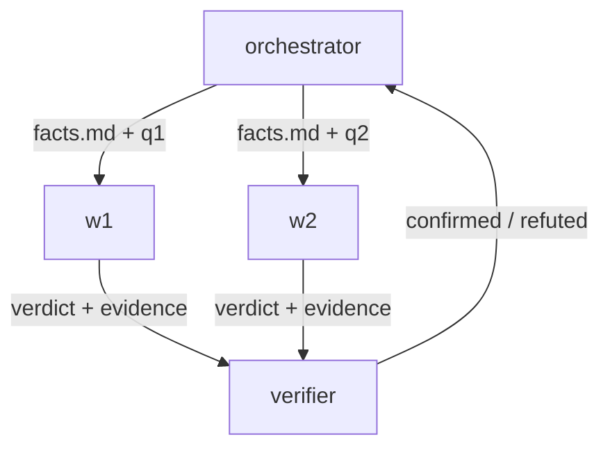

# GRAPH: <name>

질문 또는 목표 (Question or goal): <한 문장>
Layer 판정 (Layer verdict): graph (질문 <n>이 결정: <이유>)
Done check: <query, 테스트 또는 verdict 규칙>

## Node
| Node | 역할 (Role) | 입력 (Input) | 도구 / skill | Model, effort | 예산 (Budget) | 출력 (Output) | Done check |
|---|---|---|---|---|---|---|---|
| orchestrator | 계획, 라우팅, 검증, 병합 | 질문, facts.md | spawn, read | strong | <n> | 최종 보고서 | 모든 branch가 resolved 또는 UNKNOWN |
| w1-<branch> | <역할> | facts.md + 질문 | <tools> | <model> | <n> | results/w1.md | <check> |
| verifier | 주장 반박 (refute claims) | results/*.md, facts.md | read, query | strong | <n> | confirmed / refuted + 증거 | 증거가 성립함 |

## Edge
| From -> To | 실어 보내는 것 (Carries in) | 반환 (Returns) | Timeout | 부모의 검증 방법 (Parent verifies by) |
|---|---|---|---|---|
| orchestrator -> w1 | facts.md 경로, 질문 | verdict, 증거 링크, confidence, 열린 질문 | <t> | <방법> |

## 공유 state (Shared state)
- `facts.md`: append-only, 한 줄에 출처 하나, orchestrator가 쓴다.
- `results/<node>.md`: 파일마다 writer 하나.

## 한도 (Limits)
깊이 2 이하. child 6개 이하. worker는 spawn할 수 없다. 전체 예산 <n> (추정: <계산>).

## Failure route
| 이벤트 | Route |
|---|---|
| worker 과제 실패 | 새 worker로 한 번 재시도, 그다음 UNKNOWN |
| 시스템·환경 오류 | graph를 멈추고 보고 |
| 충돌하는 verdict | verifier가 결정, 또는 escalate |
| 모든 branch가 UNKNOWN 또는 refuted | 한 번 다시 계획, 그다음 멈춤 |

## 다이어그램 (Diagram)


## 실행 (Launch)
```
<orchestrator prompt>
```
